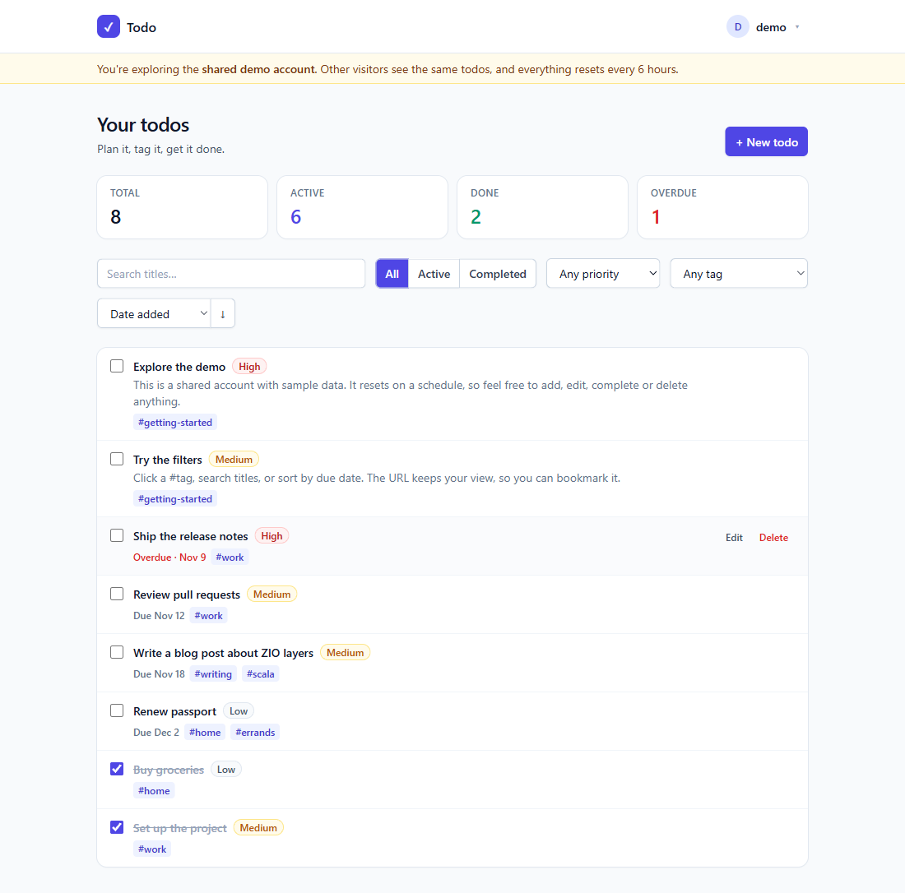
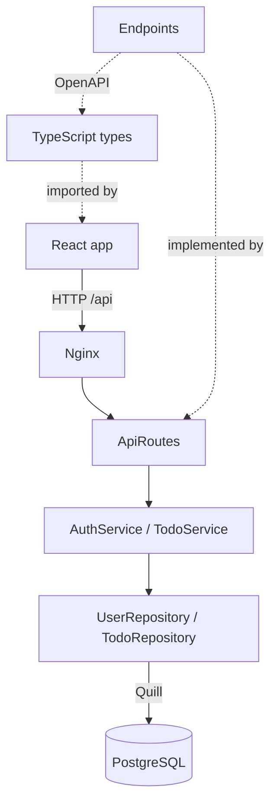
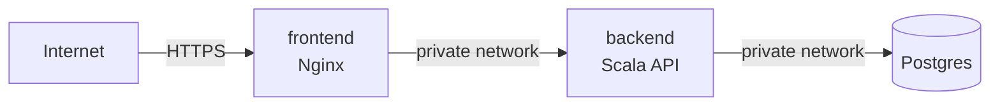

# Todo: a full-stack Scala 3 + ZIO app

A to-do list web app with accounts, due dates, priorities, tags,
search, filtering and paging.

The backend is **Scala 3** with **ZIO 2**, **Tapir** and **Quill**
on **PostgreSQL**. The frontend is **React + TypeScript**, with API
types generated from the Scala code so the two can't drift apart.

**Live demo: https://frontend-production-dc1a2c7f.up.railway.app**
(click **Try the demo** to look around without signing up, or
browse the API at
[`/docs`](https://frontend-production-dc1a2c7f.up.railway.app/docs))



## Features

- **Accounts:** register, sign in, sign out, or sign out on every
  device at once. Passwords are hashed with bcrypt, sessions are
  stored server-side and carried in an `HttpOnly` cookie, and
  repeated failed sign-ins are locked out.
- **One-click demo:** a shared demo account filled with sample
  todos, reset on a schedule, so visitors can explore without
  registering.
- **Private data:** every query is scoped to the signed-in user.
  Another user's todo is reported as "not found".
- **Todos:** create, edit, complete and delete, with notes, a
  priority, an optional due date and up to 10 tags.
- **Finding things:** filter by status, priority or tag, search
  titles, sort by four fields, and page through results. Filters
  live in the URL, so any view can be bookmarked.
- **Dashboard:** total, active, done and overdue counts. Overdue
  is worked out in the user's own time zone.
- **API docs:** Swagger UI at `/docs`, generated from the same
  code that serves the API.
- **Consistent errors:** every failure, including malformed JSON
  and out-of-range parameters, returns the same JSON shape, with
  per-field messages for validation errors.

## Tech stack

| Area     | Technologies |
| -------- | ------------ |
| Backend  | Scala 3.3 LTS, ZIO 2, Tapir, ZIO HTTP, Quill, PostgreSQL, Flyway, HikariCP, zio-json, zio-config, bcrypt |
| Frontend | React 18, TypeScript, React Router, TanStack Query, openapi-fetch, Tailwind CSS, Vite |
| Testing  | ZIO Test, Testcontainers, Tapir stub server, Vitest, Testing Library |
| Delivery | Docker multi-stage builds, Docker Compose, Nginx, GitHub Actions |

## Architecture



The backend is split into layers, and each one only talks to the
layer below it:

| Layer | Package | Responsibility |
| ----- | ------- | -------------- |
| HTTP | `http` | Endpoint definitions, request validation, mapping results and errors to JSON |
| Services | `auth`, `todo` | Use cases: register, sign in, list, update and so on |
| Repositories | `db` | SQL through Quill; one trait per table, with a Postgres implementation |
| Domain | `domain` | Types and rules with no dependencies on HTTP or the database |

**One contract, three uses.** `Endpoints.scala` describes every
endpoint as a plain value: path, inputs, outputs and errors. That
single description becomes:

1. the running server, when `ApiRoutes` attaches logic to it
2. the OpenAPI spec and Swagger UI
3. the TypeScript types the frontend compiles against

CI regenerates the spec and the types on every push and fails if
they differ from what's committed, so an API change can't ship
without the frontend being updated.

**How a request flows.** Take `PUT /api/todos/42`:

1. Tapir decodes the path, the session cookie and the JSON body.
   Anything malformed is rejected with a 400 before our code runs.
2. The security step looks up the session from the cookie and
   produces an `AuthUser`, or a 401 if it's missing, expired or
   signed out.
3. `TodoRequest.validated` turns raw strings into domain types,
   collecting every invalid field rather than stopping at the first.
4. `TodoService.update` runs the change, scoped to the owner.
5. The result becomes a `TodoResponse`. An `AppError` becomes an
   `ErrorResponse` with the right status code, and an unexpected
   failure becomes a logged 500 that reveals nothing internal.

## Scala concepts on show

| Concept | Where | Why it's used |
| ------- | ----- | ------------- |
| Typed errors in the effect type | [TodoService](backend/src/main/scala/com/example/todo/todo/TodoService.scala) | Signatures like `IO[AppError.NotFound, Todo]` state exactly how each operation can fail |
| Union types | [AuthService](backend/src/main/scala/com/example/todo/auth/AuthService.scala) (`login`) | `IO[Unauthorized \| TooManyRequests, AuthResult]` lists exactly the two ways a sign-in can fail |
| Lock-free concurrent state | [LoginRateLimiter](backend/src/main/scala/com/example/todo/auth/LoginRateLimiter.scala) | Counters live in a `Ref`, which updates atomically; a test fires 100 parallel failures to prove none slip past the limit |
| Fibers tied to a scope | [SessionService](backend/src/main/scala/com/example/todo/auth/SessionService.scala) (`live`) | A background fiber purges expired sessions hourly with `Schedule`, and `forkScoped` stops it automatically at shutdown |
| Errors vs. defects | [UserRepository](backend/src/main/scala/com/example/todo/db/UserRepository.scala), [ApiRoutes](backend/src/main/scala/com/example/todo/http/ApiRoutes.scala) | `refineOrDie` keeps a duplicate username as a typed error but turns other SQL failures into defects, which `catchAllDefect` converts to a 500 |
| Dependency injection with `ZLayer` | [Main](backend/src/main/scala/com/example/todo/Main.scala) | The whole object graph is checked at compile time; tests swap in in-memory repositories with one line |
| Effectful, resource-safe construction | [Database](backend/src/main/scala/com/example/todo/db/Database.scala), [AuthService](backend/src/main/scala/com/example/todo/auth/AuthService.scala) | The connection pool is closed when its scope ends; a layer can run effects while it's built |
| Opaque types | [Ids](backend/src/main/scala/com/example/todo/domain/Ids.scala), [User](backend/src/main/scala/com/example/todo/domain/User.scala), [Todo](backend/src/main/scala/com/example/todo/domain/Todo.scala) | `UserId`, `TodoId`, `Email` and others are free at runtime but can't be mixed up at compile time |
| Smart constructors | [User](backend/src/main/scala/com/example/todo/domain/User.scala) | `Username.make` is the only way to get a `Username`; `PlainPassword` has a private constructor and a redacted `toString` |
| Error-accumulating validation | [Validated](backend/src/main/scala/com/example/todo/domain/Validated.scala) | `zipPar` collects every field error; ZIO's `Zippable` flattens nested tuples at the type level |
| Scala 3 enums with derived instances | [LabeledEnum](backend/src/main/scala/com/example/todo/domain/LabeledEnum.scala) | One mix-in gives an enum its JSON codec, OpenAPI schema and query-parameter codec through companion givens |
| Type class derivation | [ApiModels](backend/src/main/scala/com/example/todo/http/ApiModels.scala) | `derives JsonCodec, Schema` on case classes |
| Exhaustive matching on a sealed hierarchy | [ApiModels](backend/src/main/scala/com/example/todo/http/ApiModels.scala) (`ErrorResponse.from`) | Adding an `AppError` case won't compile until it's mapped to an HTTP response. Scala only *warns* about a missing case by default, so `build.sbt` promotes that warning (E029) to an error |
| Type-checked SQL | [TodoRepository](backend/src/main/scala/com/example/todo/db/TodoRepository.scala) | Quill turns quoted Scala into SQL, including Postgres arrays, `ILIKE` and nulls-last sorting; the tests run it against real Postgres |
| Testable time | [SessionService](backend/src/main/scala/com/example/todo/auth/SessionService.scala), [SessionSpec](backend/src/test/scala/com/example/todo/SessionSpec.scala) | Time comes from ZIO's `Clock`, so session-expiry and lockout-window tests move `TestClock` forward instead of sleeping |
| Blocking isolation | [PasswordHasher](backend/src/main/scala/com/example/todo/auth/PasswordHasher.scala) | bcrypt and JDBC run on the blocking pool, keeping the async threads free |
| Typed configuration | [AppConfig](backend/src/main/scala/com/example/todo/config/AppConfig.scala) | Derived from case classes and read straight from environment variables; defaults are case-class defaults, the password is a redacted `Config.Secret`, and bad values stop startup |

## Running it

### First: create your `.env`

All configuration lives in a git-ignored `.env` file. Copy the
template and set the one required value, the database password:

```bash
cp .env.example .env
openssl rand -base64 32    # paste the output after DB_PASSWORD=
```

Docker Compose and the backend both refuse to start without it,
instead of quietly using a guessable default.

### Everything in Docker

Requires Docker.

```bash
docker compose up --build
```

All ports are bound to `127.0.0.1`, so nothing is reachable from
other machines on your network.

| What        | URL                        |
| ----------- | -------------------------- |
| App         | http://localhost:3000      |
| API docs    | http://localhost:8080/docs |
| Health      | http://localhost:8080/api/health |

### Development mode

Requires JDK 21+, sbt 1.10+, Node 20+ and Docker (for Postgres).

```bash
docker compose up -d db              # database only

cd backend && sbt run                # API on :8080, reads ../.env

cd frontend && npm install
npm run dev                          # app on :5173
```

Vite forwards `/api` to the backend, and Nginx does the same in
Docker, so the browser only ever talks to one origin and no CORS
setup is needed.

### Changing the API

After editing an endpoint or an API model in Scala:

```bash
cd backend && sbt openapi            # writes frontend/openapi.yaml
cd ../frontend && npm run gen:api    # writes src/api/schema.ts
```

TypeScript then flags any frontend code that no longer matches.

### Configuration

Every setting is an environment variable, normally set in `.env`.
The defaults are declared in
[AppConfig.scala](backend/src/main/scala/com/example/todo/config/AppConfig.scala),
and `.env.example` lists every option.

| Variable                         | Default |
| -------------------------------- | ------- |
| `DB_PASSWORD`                    | none; required |
| `DB_URL`                         | `jdbc:postgresql://localhost:5432/todo` |
| `DB_USER`                        | `todo` |
| `DB_MAX_POOL_SIZE`               | `10` |
| `HTTP_PORT`                      | `8080` |
| `HTTP_SECURE_COOKIES`            | `true` |
| `SESSION_TTL_MINUTES`            | `720` (12 hours) |
| `LOGIN_MAX_ATTEMPTS_PER_ACCOUNT` | `5` |
| `LOGIN_MAX_ATTEMPTS_PER_IP`      | `20` |
| `LOGIN_WINDOW_MINUTES`           | `15` |
| `DEMO_ENABLED`                   | `false` (Docker Compose sets `true`) |
| `DEMO_USERNAME`                  | `demo` |
| `DEMO_RESET_INTERVAL_HOURS`      | `6` |
| `APP_PORT`, `API_PORT`, `DB_PORT`| `3000`, `8080`, `5432` (Docker Compose host ports) |

Leave `HTTP_SECURE_COOKIES` on. Browsers already accept secure
cookies on `localhost`; it only needs turning off for a plain-HTTP
host with another name.

The images have two more settings of their own:

| Variable           | Image    | Default |
| ------------------ | -------- | ------- |
| `JDK_JAVA_OPTIONS` | backend  | `-Xmx256m -XX:+UseSerialGC -Xss512k` |
| `BACKEND_URL`      | frontend | `http://backend:8080` |
| `PORT`             | frontend | `80` |

The backend's heap is capped at a fixed size rather than a share
of the container's memory, because on usage-billed hosts unused
headroom still costs money.

## Deploying to Railway

The app runs on Railway as three services in one project. Only the
frontend is public; the backend and database are reachable only on
Railway's private network.



1. **Create the project.** In Railway, choose *New Project →
   Deploy from GitHub repo* and pick this repository. Rename the
   service it creates to `backend`.
2. **Configure `backend`** under *Settings*:
   - Root Directory: `/backend` (Railway finds its `Dockerfile`)
   - Watch Paths: `/backend/**`, so frontend changes don't rebuild it
   - Healthcheck Path: `/api/health`
   - No public domain
3. **Add the database:** *+ New → Database → PostgreSQL*. Keep its
   name, `Postgres`.
4. **Set the backend's variables.** The `${{...}}` references pull
   values from the Postgres service, so no password is ever typed
   or stored in the repo:

   ```
   DB_URL=jdbc:postgresql://${{Postgres.PGHOST}}:${{Postgres.PGPORT}}/${{Postgres.PGDATABASE}}
   DB_USER=${{Postgres.PGUSER}}
   DB_PASSWORD=${{Postgres.PGPASSWORD}}
   DB_MAX_POOL_SIZE=3
   DEMO_ENABLED=true
   ```

5. **Add the frontend:** *+ New → GitHub Repo*, same repository.
   Rename it `frontend`, then set Root Directory `/frontend`,
   Watch Paths `/frontend/**`, and this variable:

   ```
   BACKEND_URL=http://${{backend.RAILWAY_PRIVATE_DOMAIN}}:8080
   ```

6. **Make it public:** in the frontend's *Settings → Networking*,
   generate a domain. Railway provides HTTPS, which the `Secure`
   session cookie needs.
7. **Cap spending:** set a usage limit in your workspace's billing
   settings.

Railway redeploys each service when its files change on `main`.
Swagger UI is at `/docs` on the public domain.

## API

Signing in sets the session cookie; the browser then sends it
with every `/api` request. All `/api/todos` and `/api/tags`
endpoints require it. From the command line, let curl keep the
cookie:

```bash
curl -c jar -H 'Content-Type: application/json' \
  -d '{"username":"demo","password":"password123"}' \
  http://localhost:8080/api/auth/login
curl -b jar http://localhost:8080/api/todos
```

| Method | Path | Purpose |
| ------ | ---- | ------- |
| POST   | `/api/auth/register` | Create an account and sign in |
| POST   | `/api/auth/login` | Sign in; 429 after too many failures |
| POST   | `/api/auth/logout` | End this session |
| POST   | `/api/auth/logout-all` | End all of the user's sessions (403 for the demo account) |
| GET    | `/api/auth/demo` | Whether the demo account is enabled |
| POST   | `/api/auth/demo` | Sign in to the demo account (404 if disabled) |
| GET    | `/api/auth/me` | The signed-in user |
| GET    | `/api/todos` | List, with `completed`, `priority`, `tag`, `q`, `sort`, `order`, `page`, `pageSize` |
| POST   | `/api/todos` | Create |
| GET    | `/api/todos/{id}` | Read one |
| PUT    | `/api/todos/{id}` | Replace |
| PATCH  | `/api/todos/{id}/status` | Mark done or not done |
| DELETE | `/api/todos/{id}` | Delete |
| GET    | `/api/todos/stats` | Counts; optional `today` for the user's date |
| GET    | `/api/tags` | Every tag the user has used |
| GET    | `/api/health` | Service and database status |

Errors always look like this:

```json
{
  "code": "validation_failed",
  "message": "The request contains invalid fields",
  "fieldErrors": [
    { "field": "title", "message": "must be 1-200 characters" }
  ]
}
```

`code` is one of `validation_failed`, `bad_request`,
`unauthorized`, `forbidden`, `not_found`, `conflict`,
`too_many_requests` or `internal_error`.

## Testing

```bash
cd backend && sbt test
cd frontend && npm test
```

- **Domain and auth:** validation rules; sessions (expiry,
  revocation, hashed storage, purging); the rate limiter,
  including under concurrent load; and configuration parsing.
- **HTTP API:** real requests through the real routes,
  serialization and error handling, with in-memory repositories.
  Covers auth, the session cookie's security attributes, sign-out,
  the demo account (sample data, resets, its lockout immunity and
  restrictions), CRUD, users being isolated from each other,
  filtering, paging and every error path.
- **Repositories:** the actual SQL against PostgreSQL 18 in Docker,
  using Testcontainers. These skip themselves when Docker isn't
  running, and always run in CI.
- **Frontend:** URL filter parsing, date logic, session handling
  (including that sign-in stores nothing in the browser), and
  components, such as server validation errors appearing next to
  the right form fields.

`sbt check` runs the formatter check and all tests, as CI does.

## Project structure

```
backend/src/main/scala/com/example/todo/
├── Main.scala             # wiring and startup
├── GenerateOpenApi.scala  # writes the OpenAPI spec
├── config/                # typed configuration
├── domain/                # types, validation, errors
├── auth/                  # passwords, sessions, rate limiting
├── demo/                  # the shared demo account
├── todo/                  # todo use cases
├── db/                    # Quill repositories, migrations
└── http/                  # endpoints, routes, API models

frontend/src/
├── api/                   # typed client, generated types
├── auth/                  # session state
├── components/            # UI pieces
├── pages/                 # sign-in and todo pages
└── lib/                   # dates and URL filters
```

## Security

**Server-side sessions.** Signing in creates a random 256-bit
session token. The browser holds the token; the database holds
only its SHA-256 hash, so a leaked copy of the table can't be used
to sign in. Every request checks the session in the database,
which means:

- signing out ends the session immediately, and a copied cookie
  stops working
- "Sign out of all devices" (in the account menu) ends all of a
  user's sessions at once
- expired sessions are purged by a background job

**The session can't be stolen by a script.** The token travels in
a cookie with these attributes:

| Attribute         | What it prevents |
| ----------------- | ---------------- |
| `HttpOnly`        | JavaScript can't read it, so even an XSS bug can't steal the session |
| `SameSite=Strict` | The browser won't send it on requests started by other sites, which blocks cross-site request forgery |
| `Secure`          | It's never sent over plain HTTP |
| `Path=/api`       | It isn't sent with page or asset requests |
| `Max-Age`         | It expires with the session |

The token never appears in a response body, and the frontend
stores nothing in `localStorage` or `sessionStorage`. Tests check
each of those points.

**Sign-in lockout.** Failed sign-ins are counted per account (5 in
15 minutes) and per client address (20 in 15 minutes). Past either
limit, sign-in returns 429, even with the right password, so a
locked-out attacker learns nothing. A success clears the account's
count. Nginx overwrites `X-Forwarded-For` with the real address,
so a client can't dodge the per-address limit by faking it.

**Layered defences in Nginx.** A strict Content Security Policy
only lets the page load scripts, styles and data from its own
origin, so injected scripts and calls to other servers are
blocked. `X-Frame-Options`, `nosniff` and a `Referrer-Policy` are
set too.

**No secrets in the repo.** The database password comes from a
git-ignored `.env` file with no fallback value, and it's a
`Config.Secret`, so it's redacted if the config is ever logged.
Ports are bound to `127.0.0.1` only.

**A demo account that can't be hijacked or locked.** The demo
account has no password anyone knows: each reset sets a new random
one that is never stored or shown, so the only way in is the
*Try the demo* button. That also makes it immune to the sign-in
lockout, which counts failed passwords. Because every visitor
shares it, the API refuses (403) to let it sign out all sessions,
which would sign out everyone else.

**Known limits.** The lockout counters are kept in memory, so they
reset on restart and aren't shared if you run several backend
instances; a shared store such as Redis would fix both. A lockout
also means someone who knows a username can lock its owner out
for 15 minutes, which is the usual trade-off for this kind of
protection.

## Design decisions

- **Not found, not forbidden.** Requests for another user's todo
  get a 404, so the API doesn't confirm which IDs exist.
- **Equal login timing.** Sign-in checks a password even for
  unknown usernames, so response time doesn't reveal which
  accounts exist.
- **Database errors are defects.** Inputs are validated before
  reaching the database, so a SQL error there means something is
  broken. Those failures skip the typed error channel and become a
  500. Only a duplicate username or email is expected, and it's
  modelled as a `Conflict`.
- **Client-supplied "today".** Overdue depends on the user's
  local date, so the frontend sends it rather than the server
  guessing from UTC.
- **One origin.** Nginx (and Vite in development) serves the app
  and proxies `/api`, so there's no CORS configuration to get
  wrong and the session cookie is always first-party.
